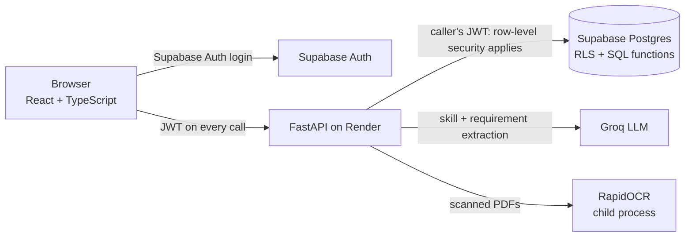

# SprintBridge

**One platform that connects students and job seekers with recruiters, universities, mentors and founders, built on evidence instead of claims.**

A student uploads a resume and sees their skills with the exact lines that prove them, how well they fit each opening, and which mentor can close the gap. Universities run campus drives with eligibility enforced by the database; recruiters hire with a snapshot of each applicant; independent mentors verify skills so nobody can buy a badge from a friend.

| | |
|---|---|
| **Live app** | https://sprintbridge-frontend.onrender.com |
| **API health** | https://sprintbridge-api.onrender.com/api/health |
| **Demo walkthrough** | [docs/showcase-workflow.md](docs/showcase-workflow.md): every flow step by step, demo accounts, a 12-minute demo order |
| **Flow diagrams** | [docs/diagrams/](docs/diagrams/): one per user type, ready for slides |

> The free Render instance sleeps after 15 idle minutes. Open the API health link a minute before a demo.

---

## What it does

| For | What they get |
|---|---|
| **Students & job seekers** | Resume → skills grouped by category, each with a level and the quotes behind it · openings ranked by fit · paste any job description for a fit report with scam warnings · campus drives with clear eligibility reasons · application tracker |
| **Recruiters** | Public and campus listings · applicants with a frozen profile + eligibility snapshot · shortlist / offer / reject, audited |
| **Universities** | Roster import (preview, all-or-nothing) · drive authorization with eligibility rules · campus applicants and placement report with safe CSV export |
| **Mentors** | Directory ranked by verified expertise (price never affects rank) · paid sessions held in escrow · independent skill verification, same fee pass or fail |
| **Founders** | Ventures with a public teaser and a private plan unlocked only after an NDA and acceptance |
| **Operators** | Role approvals, scam reports (auto-hide after 3), disputed payouts, audit log |

### How people get their role

Everyone signs up the same way and chooses what they're joining as. Students are linked when their university imports its roster with their email; founders need no approval; **recruiters, universities and mentors apply, and an operator approves** before their workspace opens. Nobody can grant themselves a role: the database only creates memberships inside the operator's audited approval function.

### The skill engine

1. The server extracts the resume's text itself, or reads a scanned PDF with OCR (RapidOCR, runs locally).
2. Groq (`openai/gpt-oss-120b`, fallback `gpt-oss-20b`) extracts skills with **verbatim quotes**. Any quote not found in the resume is dropped, so the model cannot invent evidence, and instructions hidden in a resume have no effect.
3. A deterministic pass finds every known skill named in the resume, with its section and dates, so results don't vary between runs.
4. **Python computes every score**: evidence points → level 1–3 (only a mentor certifies level 4) → fit = required skills weighted 2, preferred 1, scaled by evidence confidence (mentor-verified 1.0, system-assessed 0.8, self-declared 0.3).
5. Groq calls are budgeted locally against its rate limits; identical resumes and job descriptions are served from cache.

Details: [docs/skill-intelligence.md](docs/skill-intelligence.md).

---

## Architecture



- **Every rule lives in the database.** Row-level security on every table, column-level grants, and SQL functions for every multi-step action (apply, authorize a drive, pay, verify, approve a role). Rules hold even if someone calls the database directly.
- **The backend acts as the caller.** It forwards the user's verified token (ES256, checked locally against Supabase's keys), so the database applies that user's permissions. A narrow service client touches only server-owned tables.
- **One error shape** (`detail`, `code`, `field_errors`, `request_id`) and one pagination envelope across 55 API operations, each listed in [docs/api-contract.md](docs/api-contract.md) and checked by a test.
- **Payments are test mode**: clearly labelled, no card charged; escrow, commission, holds, refunds and disputes are real logic.

| Layer | Stack |
|---|---|
| Frontend | React 19, TypeScript, Vite, Tailwind v4, Supabase JS (auth only) |
| Backend | Python 3.13, FastAPI, Pydantic v2, supabase-py, httpx, pypdf, RapidOCR |
| Database | Supabase PostgreSQL 17: 18 migrations, RLS, SQL functions, audit log |
| AI | Groq (OpenAI-compatible API), strict JSON-schema output |
| Hosting | Render (API web service + static site), Blueprint in `render.yaml` |

---

## Repository layout

```text
backend/
  app/main.py          app factory: request IDs, CORS, error handlers, routers
  app/auth.py          token verification (local ES256 via JWKS, remote fallback)
  app/db.py            request-scoped client (caller's token); narrow service client
  app/routers/         one module per domain: me, opportunities, applications, university,
                       drives, mentors, skills, ventures, verification, billing, trust, onboarding
  app/schemas/         Pydantic models = the API contract
  app/services/        llm (Groq), documents (PDF text, OCR), ocr_worker, normalize (aliases,
                       categories, skill mentions), skill_profile, fit, coverage, roster CSV, CSV export
  tests/               unit tests, no network
  tests_live/          end-to-end journeys against the live Supabase project
database/
  migrations/          0001–0018 SQL: tables, constraints, RLS, grants, SQL functions
  apply_migrations.py  applies new migrations once each
  seed.py              demo organizations, users, listings, mentors, ventures
  reset_demo.py        clears demo activity and re-seeds (asks for --yes)
  tests/               schema and row-security tests on a throwaway local Postgres
frontend/
  src/pages/           one page per screen; src/lib/ API client and types
  tests/               Vitest unit tests and Playwright journeys
docs/                  architecture, API contract, threat model, skill engine, business model,
                       showcase workflow, diagrams
render.yaml            Render Blueprint (API + static site)
```

---

## Run it locally

You need Python 3.13 with [`uv`](https://docs.astral.sh/uv/), Node 24, and a Supabase project.

**1. Database** (settings come from `backend/.env`; `DATABASE_URL` must be the Supabase **session pooler** URI, with special characters in the password URL-encoded, e.g. `@` → `%40`):

```bash
cp backend/.env.example backend/.env          # fill in Supabase URL, keys, DATABASE_URL, GROQ_API_KEY
set -a; . backend/.env; set +a
uv run --with 'psycopg[binary]' python database/apply_migrations.py
uv run --with 'psycopg[binary]' python database/seed.py
```

In Supabase Auth, keep **email confirmation** on, and set the Site URL and Redirect URLs to where the frontend runs.

**2. Backend**

```bash
cd backend
uv venv .venv --python 3.13 && uv pip install --python .venv/bin/python -r requirements-dev.txt
.venv/bin/uvicorn app.main:app --reload       # http://localhost:8000/docs
```

Without `GROQ_API_KEY`, resume and job-description analysis return a clear 503 and everything else works.

**3. Frontend**

```bash
cd frontend
npm ci
cp .env.example .env.local    # VITE_API_BASE_URL=http://localhost:8000 (no /api), Supabase URL + publishable key
npm run dev                   # http://127.0.0.1:5173
```

**Reset the demo** (deletes all activity, keeps demo accounts, re-seeds; undoes role approvals):

```bash
uv run --with 'psycopg[binary]' python database/reset_demo.py --yes
```

---

## Tests

| Suite | Command | Count |
|---|---|---|
| Backend unit (no network) | `cd backend && .venv/bin/python -m pytest -q` | 85 |
| Live journeys (real Supabase, cleans up) | `cd backend && .venv/bin/python -m pytest tests_live -q` | 9 |
| Database schema and row security | `uv run --python 3.12 --with pgserver --with 'psycopg[binary]' --with pytest pytest database/tests -q` | 66 |
| Frontend unit | `cd frontend && npm test` | 7 |
| Frontend journeys (Playwright) | `cd frontend && npx playwright test` | 11 |

`database/tests/supabase_shim.sql` only imitates Supabase's `auth` schema for local tests. Never apply it to a real project.

---

## Deploy

`render.yaml` is a Render Blueprint (Free plan): in Render choose **New → Blueprint → this repository** and enter the secrets in the dashboard.

| Service | Secrets |
|---|---|
| `sprintbridge-api` | `SUPABASE_URL`, `SUPABASE_PUBLISHABLE_KEY`, `SUPABASE_SECRET_KEY`, `GROQ_API_KEY`, `ALLOWED_ORIGINS` (the frontend URL) |
| `sprintbridge-frontend` | `VITE_API_BASE_URL` (the API origin, no `/api`), `VITE_SUPABASE_URL`, `VITE_SUPABASE_PUBLISHABLE_KEY` |

Known limit: OCR of scanned resumes needs more memory than the free 512 MB instance has; text PDFs work there. A 2 GB instance runs OCR too.

---

## Documentation

| Document | What's in it |
|---|---|
| [docs/showcase-workflow.md](docs/showcase-workflow.md) | Every user flow step by step, demo accounts, what is real vs simulated |
| [docs/architecture.md](docs/architecture.md) | System design, roles, data model, API rules |
| [docs/api-contract.md](docs/api-contract.md) | Every endpoint, payload and error code |
| [docs/skill-intelligence.md](docs/skill-intelligence.md) | Skill engine: extraction, scoring, fit, OCR, rate limits |
| [docs/threat-model.md](docs/threat-model.md) | Abuse cases and the controls for each |
| [docs/business-model.md](docs/business-model.md) | Plans and pricing |
| [plan.md](plan.md), [todo.md](todo.md) | Original sequential build plan |

## Secrets

`.env` files are git-ignored. The Supabase secret key and the Groq key are backend-only; only the Supabase URL and publishable key go into the frontend. Never put keys in Git, screenshots or slides.
