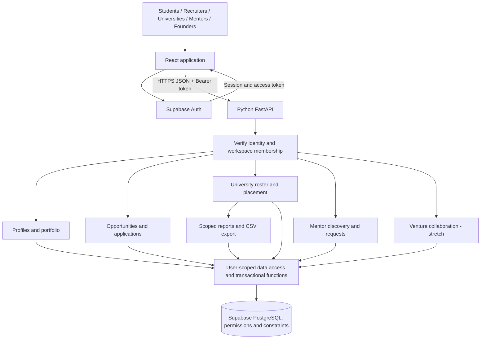
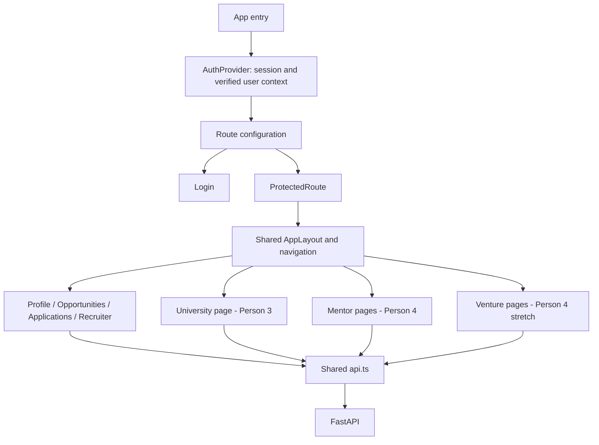
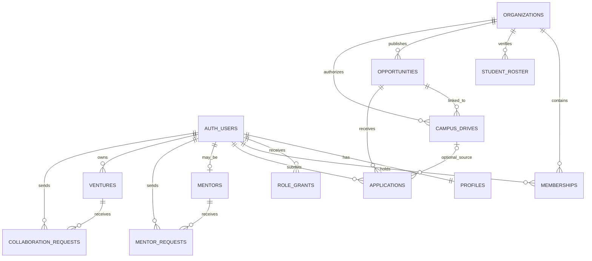
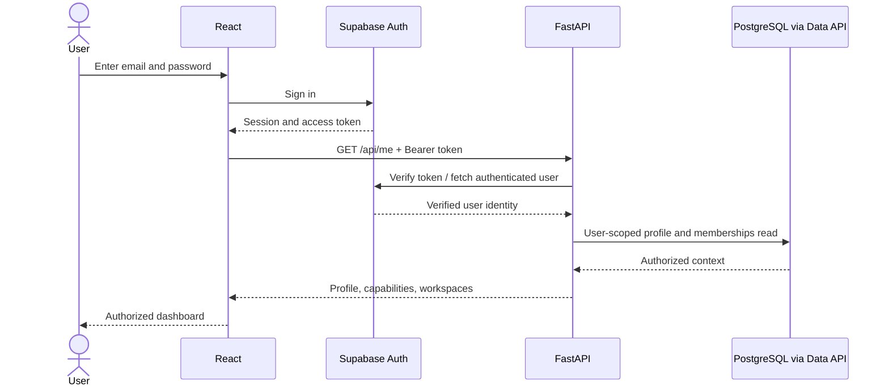
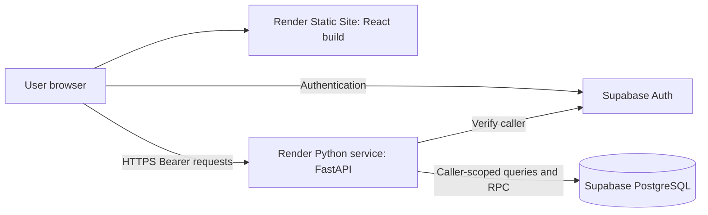

# SprintBridge — whole-project architecture and team ownership

Design draft · 17 October 2026 · Four teammates · 12-hour hackathon

This document defines the complete system structure before implementation. It covers the five-pillar product and identifies what belongs in the hackathon versus later releases. It does not create application code, cloud resources, or deployments. Execution schedule: [hackathon plan](../plan.md). Sequential steps: [checklist](../todo.md).

Compared with the seven supplied hackathon documents on 17 October 2026. Useful concepts are incorporated below; conflicting product/time/auth assumptions are not. The comparison and merge-decision notes (`architecture-comparison.md`) are not in this repo; they covered source attribution, accepted changes, deferred features, and unavailable referenced documents.

## 1. Architecture decision

Build a modular monolith: one React frontend, one Python FastAPI application containing domain modules, and one Supabase PostgreSQL database with Supabase Auth. Modules have separate files and owners but run together. All four people work on one product and repository.

Keep business operations behind FastAPI. The browser talks directly to Supabase only for authentication. Database access rules must remain safe even if a user attempts to call Supabase's exposed Data API directly.

| Concern | Choice | Purpose |
|---|---|---|
| Interface | React + TypeScript + Vite + Tailwind | Shared responsive interface for every role |
| Navigation | React Router | Login and role-aware application routes |
| Client state | React context for authentication/workspace; local state for forms/data | Small state surface suited to the time limit |
| HTTP | One fetch wrapper | Token attachment, parsing, errors, cancellation |
| Backend | Python + FastAPI + Pydantic + Uvicorn | Typed HTTP endpoints, access checks, business services |
| Identity | Supabase Auth | Authentication and session lifecycle |
| Persistence | Supabase Free PostgreSQL | Shared relational data and constraints |
| Database access | Supabase Python client using caller JWT; one narrow service client for server-owned tables | User-scoped reads, writes and function calls under RLS. Only `resumes`, `skill_evidence` and `job_requirements` are written with the secret key ([api-contract.md](api-contract.md) §5). |
| Hosting | Render static frontend and Python service, Free tiers | Separate frontend/API deployment with shared database |
| Skill extraction | Claude API via the Anthropic Python SDK, inside FastAPI (`services/llm.py`) | Resume/JD → structured skills with cited evidence; see [skill-intelligence.md](skill-intelligence.md) |
| Tests | Frontend build/manual journey checks; pytest and database integration checks | Verify demo behavior and critical access boundaries |

There is no cache server, broker, search cluster, separate AI service, microservice deployment, or custom password database in this design. LLM calls run inside the existing FastAPI app. **The LLM extracts with cited evidence; it never scores.** All scores and fit values come from deterministic Python formulas. Later modules can be added inside the same application.

## 2. Whole-system view



The API uses Auth to verify callers, then reads server-owned roles and memberships. Its service calls validate operations; database grants, row-level rules, functions, and constraints protect the stored result. Frontend visibility is a user-experience aid, not an authorization mechanism.

## 3. Roles, workspaces, and visibility

A user has one identity and can hold multiple capabilities. Organization membership determines which company/university workspace they can use. Being a university student does not make someone a university administrator. Frontend workspace selection must come from the list returned by the server.

| Actor | Permitted actions | Never automatically receives |
|---|---|---|
| Student / job seeker | Edit own profile; discover; apply; view own applications; request mentorship/collaboration | Recruiter decisions, other students' applications, university admin access |
| Recruiter | Create company listings; review own company applicants; change permitted hiring statuses | University rosters, another company's applicants |
| University admin | Import own roster; authorize own campus drives; see own drive participation; export scoped reports | Every public application by its students, employer decision authority |
| Mentor | Manage own profile and requests; accept/decline | Private academic records, other mentors' inboxes |
| Founder | Manage own venture and collaboration requests | Employment decisions or automatic ownership of collaborators' work |
| Operator | Controlled setup and later moderation | A browser-exposed privileged database credential |

University and company organizations remain independent. `campus_drives` links an authorized university drive to a company opportunity; it does not represent a required commercial partnership. Public opportunities require no university membership.

**Two visibility spaces:** `opportunities.visibility` is `public` or `campus`, defaulting to `public`. Public listings are discoverable across institutions. A campus listing is visible only to its company, authorized university admins, and students verified in a university with an authorized drive for that listing. Those students may see a sanitized drive summary and eligibility reasons; eligibility governs application, not their ability to understand why they fail. Unpublished/unlinked campus listings remain company-only. For `campus` listings, submission requires an authorized `drive_id`; omitting it must not bypass eligibility. A public listing can also be linked to a campus drive: a general public application remains valid without campus privileges, but only applications submitted through that authorized drive enter university reports. Enforce these distinctions in list, detail, submission, database reads, and export paths.

For multiple-role users, `/api/applications?scope=student`, `scope=recruiter`, or `scope=university` selects a view. Organization views also send `workspace_id`. The backend verifies that the caller holds the requested membership; the parameter is never accepted as proof of access. Frontend clears/refetches scoped data when the workspace changes.

## 4. Frontend architecture — Person 1 leads



### Routes and screen ownership

| Route | Contents | UI owner |
|---|---|---|
| `/login` | Email/password, loading/error handling | P1 |
| `/dashboard` | Role-appropriate shortcuts; only real counts if available | P1 |
| `/profile` | Name, specialization, skills, education summary, portfolio URL | P1 |
| `/opportunities` | Search/filter and listing cards | P1 |
| `/opportunities/:id` | Listing, separate eligibility and skill-coverage explanation, evidence label, mentor next action; optional authorized drive context | P1 |
| `/applications` | Student application statuses | P1 |
| `/recruiter` | Tabs: opportunities, create form, applicants | P1 |
| `/university` | Tabs: roster, drives, campus applicants, report | P3 |
| `/mentors` | Niche/skill discovery and request form; accepts a missing-skill filter from opportunity detail | P4 |
| `/mentor-requests` | Requester/mentor views determined by authorized context | P4 |
| `/ventures`, `/ventures/:id` | Idea discovery/create, requests and acceptance | P4, stretch |

Each page imports shared controls and API helpers; it must not create its own navigation shell, Supabase business-data client, or authentication system. P3/P4 export their page components; P1 registers them centrally.

### State and data flow

- Supabase's browser SDK owns authentication/session persistence and refresh. AuthProvider observes its session; do not build separate manual JWT storage logic.
- `/api/me` supplies display profile, capabilities, and permitted workspaces. Refresh context on login/workspace changes and authorization failures.
- Form values, filters, and pending/error states stay in page/component state. Share only authentication and active workspace globally.
- `api.ts` obtains the current access token, adds `Authorization: Bearer ...`, handles JSON/non-JSON failures, and returns a typed result. Handle CSV downloads separately as blobs.
- Cancel/ignore outdated reads when filters, route IDs, or workspaces change. Never show a previous workspace's data under the new workspace heading.
- After successful writes, refetch affected lists. Do not optimistically show acceptance/shortlisting before the server confirms it.
- A failed write with an unknown outcome is not automatically retried. Check the current saved record before retrying where duplicates are possible.

Shared UI: Button, Input, Select, Card, Table, StatusBadge, EmptyState, LoadingState, ErrorMessage, AppLayout, ProtectedRoute. Keep styling uniform and keyboard-usable. Reserve academic details for authorized university views rather than the public profile component.

**Evidence labels:** show `Self-declared skills`, `Portfolio link supplied` when present, and `University-claimed` (not "verified") where a roster link exists. The roster CSV is university-supplied and can be fabricated. Only externally fetched academic records and independently assigned verifiers earn `Verified` labels (post-hackathon; see the trust ladder in [threat-model.md](threat-model.md) §1–2). Skills carry one of three labels: `Self-declared`, `System-assessed · level N · score` (evidence the engine found in an uploaded resume, or later in OAuth-connected GitHub), or `Mentor-verified` (granted only by an independently assigned mentor). The system never labels its own output "verified" ([skill-intelligence.md](skill-intelligence.md) §1). A GitHub/demo URL alone does not prove the claimed skills and never creates a verified badge. Accept only valid HTTP(S) portfolio URLs; render user text as text, open external links safely, and do not scrape portfolio links on the server. GitHub is read only through the user's OAuth connection (post-hackathon), and a pasted JD URL is fetched once as text with a timeout ([skill-intelligence.md](skill-intelligence.md) §3.2, §6). Multiple artifacts, reviewer-issued credentials, and private sharing are deferred.

## 5. Python backend architecture — shared modules

Request → router → Pydantic input validation → verified actor/workspace → domain service → user-scoped database access/function → response schema.

| Module | Responsibilities | Owner |
|---|---|---|
| `auth` | Token verification, actor lookup, memberships, access helpers | P2 |
| `profiles` | Editable public profile fields, skills, portfolio URL | P2 |
| `opportunities` | Company ownership, listing create/read, status/deadline | P2 |
| `applications` | Unique application, campus context, applicant visibility, hiring status updates | P2 |
| `university` | Roster import, campus-drive authorization and discovery | P3 |
| `eligibility` | Normalize inputs, fetch authoritative evaluation, expose reasons | P3 |
| `reports` | Campus-scoped counts and safe CSV export | P3 |
| `mentors` | Mentor discovery, request ownership, accept/decline | P4 |
| `ventures` | Venture ownership, collaboration request/acceptance | P4, stretch |

Use FastAPI routers to assemble these modules into one application. Keep schemas alongside each domain and shared authentication in dependencies. The framework supports this file/module organization through `APIRouter`; see [FastAPI larger applications](https://fastapi.tiangolo.com/tutorial/bigger-applications/).

External calls need explicit timeouts and controlled errors. Return actionable client messages without SQL, tokens, or stack traces. Log request ID, route, status, duration, and a non-sensitive error code. Do not log passwords, Authorization headers, raw CSV contents, or academic fields.

## 6. Database model

Use UUID primary keys, foreign keys, UTC timestamps, and constrained status values. JSON names use snake_case throughout. For hackathon skills, normalized text arrays and a small shared vocabulary suffice; normalized skill tables are a later migration if needed.

| Table | Key fields | Important rule |
|---|---|---|
| `profiles` | `user_id`, `name`, `specialization`, `education_summary`, `skills[]`, `portfolio_url`, `is_public` | User edits own allowed fields; contains no privileged role or verified CGPA |
| `role_grants` | `user_id`, `role` | Server/setup-owned; unique pair; user cannot grant themselves mentor/admin privileges |
| `organizations` | `id`, `name`, `type` | Company or university |
| `memberships` | `user_id`, `organization_id`, `role` | Unique pair/role, checked per request |
| `student_roster` | `id`, `university_id`, `student_id`, `name`, `email`, `verified_user_id?`, `branch`, `batch`, `cgpa?` | Unique university/student ID; verified links never derived from untrusted CSV alone |
| `opportunities` | `id`, `company_id`, `title`, `description`, `type`, `visibility`, `required_skills[]`, `compensation_amount?`, `currency?`, `pay_period?`, `deadline`, `status`, `created_by` | Owning company controls listing; visibility public/campus; status open/closed for demo |
| `campus_drives` | `id`, `university_id`, `opportunity_id`, `allowed_branches[]`, `batch`, `min_cgpa?`, `required_skills[]`, `deadline`, `rules_version`, `authorized_by` | University authorization; freeze eligibility rules once published for hackathon |
| `applications` | `id`, `opportunity_id`, `applicant_id`, `drive_id?`, `status`, `eligibility_snapshot?`, `profile_snapshot`, `created_at`, `updated_at` | Unique applicant/opportunity; drive must reference the same opportunity |
| `mentors` | `id`, `user_id`, `niche`, `experience_summary`, `is_active` | Unique mentor user; skill filter uses linked profile skills with consented public projection; private fields excluded |
| `mentor_requests` | `id`, `mentor_id`, `requester_id`, `note`, `status`, `created_at` | One request per requester/mentor for demo; only owning mentor decides |
| `ventures` — stretch | `id`, `founder_id`, `title`, `problem`, `industry`, `stage`, `needed_skills[]` | Founder owns changes |
| `collaboration_requests` — stretch | `id`, `venture_id`, `requester_id`, `note`, `status` | Unique requester/venture; accepted rows represent team membership in demo |

`auth.users` is managed by Supabase. `profiles.skills[]` stays self-declared permanently. Post-hackathon verified skills, academic records, subscriptions and payments live in separate server-owned tables ([threat-model.md](threat-model.md) §12, [business-model.md](business-model.md) §5). The ten core application tables above exclude the two stretch tables and managed Auth tables. The hackathon skill-intelligence slice adds four server-written tables: `resumes`, `skill_evidence`, `job_requirements`, `external_jds` ([skill-intelligence.md](skill-intelligence.md) §11). This is an agreed exception to the ten-table core. In this architecture, `role_grants` makes privileged capabilities explicit instead of embedding them in an editable profile.



Student roster rows may exist without an account. The seeded verified user link is optional and institution-specific. Organizations are typed; company ownership and university ownership must validate the appropriate organization type.

### Constraints, transactions, and direct-access safety

1. Enable RLS and explicit grants on exposed tables. Read policies enforce owner/company/university scope. Private roster data remains separate from public profiles; row security alone does not hide individual columns. Grant application reads only for safe columns; expose sensitive eligibility snapshots through an explicitly scoped read function when needed. Do not grant whole-table SELECT and rely on the frontend to omit private columns. Any read views must preserve the caller's security context.
2. Prevent updates to IDs/owners/status through generic edit paths. Profile edits allow only the named editable fields. Role grants and membership creation are setup-only for the demo.
3. Use database uniqueness for duplicate applications/requests; button disabling is only a convenience.
4. Application submission is a transactional database operation: derive the caller, validate the listing and optional drive, evaluate the current verified record and rules, create snapshots, insert one application. Deny direct application inserts/updates that could bypass those checks.
5. Roster commit is one transactional operation with validated rows, ownership checks, and unique constraints; it preserves existing verified-user links. Reimport updates the intended rows rather than multiplying them.
6. Status changes and request decisions use constrained operations that verify actor and transition. Calling a Supabase function directly must enforce the same rules as calling FastAPI.
7. For functions that need elevated execution privileges, explicitly check `auth.uid()` and ownership, fix `search_path`, qualify relation names, restrict execute grants, and expose only the minimum operation. Prefer ordinary invoker functions when they suffice. Review/test these boundaries before demoing private workflows.

Supabase documents the distinct roles of [database grants and row-level security](https://supabase.com/docs/guides/database/postgres/row-level-security), and permission considerations for [database functions](https://supabase.com/docs/guides/database/functions). Using caller JWTs does not remove the need to constrain direct table writes and function calls.

**Eligibility refinement:** Python's eligibility service orchestrates validation and returns readable results; one database predicate is authoritative for both the eligibility endpoint and atomic application submission. This avoids a preview/apply race and two drifting eligibility algorithms. P3 owns the predicate and fixtures; P2 calls the transactional submit operation. This refines the earlier high-level plan's “plain Python eligibility” implementation detail.

## 7. Authentication and session sequence



Verify access tokens using the supported Auth user verification operation for the hackathon. Do not merely decode claims. Invalid/expired identity returns 401. Provider outage returns an unavailable response rather than falsely claiming the user's credentials are wrong. See [Supabase JWT guidance](https://supabase.com/docs/guides/auth/jwts).

Use a fresh request-scoped data client so simultaneous users cannot overwrite one global client's authentication state. The frontend SDK handles session refresh; retry failed reads at most once after a successful refresh. Mutations follow their retry contract. Logout clears user/workspace data. Seed authenticated demo identities; no fake role-header authentication.

## 8. API contract for the whole team

Base path `/api`. Auth routes are supplied by Supabase rather than duplicated in FastAPI. Use UUID identifiers, ISO UTC timestamps, snake_case keys, lowercase enum values, and explicit nullable fields.

Lists return `{ "items": [...], "page": 1, "page_size": 20 }`, optionally `total` when inexpensive. Default page size 20, maximum 100, stable ordering by creation time then ID. Every list, including request inboxes and roster, supports pagination. CSV export covers the authorized filtered dataset, not just the current UI page.

Errors retain the agreed top-level `detail` string and add a stable code:

```json
{
  "detail": "You do not meet this drive's eligibility rules.",
  "code": "NOT_ELIGIBLE",
  "field_errors": {},
  "request_id": "request-reference"
}
```

Map 401 to login required, 403 to prohibited action, 404 to missing/not-visible private record, 409 to duplicate or invalid transition, 422 to invalid input, and 503 to an unavailable dependency. Adapt FastAPI validation errors into this same shape. Do not ask the frontend to parse message text for business logic.

### Resource routes and ownership

| Endpoint | Input / result | API owner | Consumer |
|---|---|---|---|
| `GET /health` | Liveness, no private configuration | P2 | Deployment |
| `GET /me` | Current profile + capabilities + workspace summaries | P2 | P1 |
| `PATCH /me` | Allowlisted profile patch → saved profile | P2 | P1 |
| `GET /opportunities` | Search/type/page filters → only visible listing summaries | P2 | P1 |
| `POST /opportunities` | Authorized company context + listing fields → saved listing | P2 | P1 |
| `GET /opportunities/{id}` | Authorized listing + applicant-specific `skill_coverage` object (fallback when no analysis exists) | P2 | P1 |
| `POST /me/resume`, `GET /me/skills` | Resume upload → evidence-backed skills with labels and "why" | P2 | P1 |
| `GET /opportunities/{id}/fit`, `POST /jds`, `GET /jds/{id}/fit` | Fit score + gap report for a listing or a pasted JD ([skill-intelligence.md](skill-intelligence.md) §5–7) | P2 | P1/P4 |
| `POST /opportunities/{id}/applications` | Optional drive ID → saved application | P2, uses P3 rules | P1/P3 |
| `GET /applications` | Validated scope/workspace/page → appropriate application projection | P2 | P1/P3 |
| `PATCH /applications/{id}` | Allowed status only → saved application | P2 | P1 recruiter UI |
| `GET /university/roster` | Authorized university context/page → private roster | P3 | P3 |
| `POST /university/roster/preview` | Multipart CSV → validated row preview + errors | P3 | P3 |
| `POST /university/roster/commit` | CSV + validated context, fully revalidated → import summary | P3 | P3 |
| `GET /university/drives` | Context/page → admin-owned or verified-campus-student sanitized drives; application eligibility separate | P3 | P3 |
| `POST /university/drives` | Linked opportunity + rule fields → authorized drive | P3 | P3 |
| `GET /drives/{id}/eligibility` | Current student → boolean, reasons, skill lists, version | P3 | P1/P3 |
| `GET /university/report` | University/branch/batch filters → counts | P3 | P3 |
| `GET /university/report.csv` | Same filters → CSV download | P3 | P3 |
| `GET /mentors` | Optional niche/skill/page → active visible mentor summaries with matching skill reason | P4 | P4 |
| `POST /mentor-requests` | Mentor ID + note → saved request | P4 | P4 |
| `GET /mentor-requests` | Validated requester/mentor scope/page → requests | P4 | P4 |
| `PATCH /mentor-requests/{id}` | Accepted/declined → saved request | P4 | P4 |
| `GET/POST /ventures` | List filters or idea fields → list/saved venture | P4 stretch | P4 |
| `GET /ventures/{id}` | Venture details | P4 stretch | P4 |
| `POST /ventures/{id}/requests` | Note → saved collaboration request | P4 stretch | P4 |
| `GET /collaboration-requests` | Authorized requester/founder scope/page → requests | P4 stretch | P4 |
| `PATCH /collaboration-requests/{id}` | Accepted/declined → saved request | P4 stretch | P4 |

Every router defines Pydantic input/output schemas. Person 1 mirrors those wire types in TypeScript or uses generated OpenAPI types if generation is already familiar to the team. Freeze example responses before splitting work; schema generation is optional, contract agreement is required.

Application projections vary by scope but keep core keys stable: id, opportunity_id, title, applicant_id, status, created_at. Only authorized recruiter/campus views include the submitted profile snapshot; academic eligibility evidence is returned only where needed. Do not expose the entire database row by default.

### Example eligibility response

```json
{
  "drive_id": "11111111-1111-4111-8111-111111111111",
  "eligible": false,
  "reasons": [{ "code": "MISSING_REQUIRED_SKILL", "message": "Python is required." }],
  "matching_skills": ["sql"],
  "missing_skills": ["python"],
  "rules_version": 1
}
```

Required skills in a drive are hard eligibility requirements. Missing skills on a general opportunity are informative in the hackathon unless that listing explicitly defines them as mandatory; do not silently treat a match percentage as permission to apply.

### Two-stage decision and actionable skill gap

Adopt the supplied architecture's distinction between a hard gate and explainable fit, using the smallest transparent calculation:

1. **Eligibility/access:** validate listing visibility, status/deadline, and, when using a drive, institution membership, branch, batch, CGPA, and mandatory skills. A high skill score cannot override a failed gate. A failed gate returns explicit reasons.
2. **Skill coverage:** for unique normalized opportunity-required skills, let `n` be the requirement count and `m` the matching count. Return `matched_count`, `required_count`, `matching_skills`, `missing_skills`, and `coverage_percent = round(100 * m / n)` for `n > 0`; otherwise return null and show `No required skills specified`. Display `3 of 4 required skills · 75% coverage`, not a hiring probability or validated competency score. Drive-only mandatory skills remain in the separate eligibility reasons; do not hide them by changing the denominator.
3. **Next action:** each missing skill offers `Find a mentor for this skill`, linking to `/mentors?skill=<encoded-skill>`. P4 filters visible active mentors by normalized linked-profile skills; deterministic ordering by mentor name then ID is enough. Show the matched skill as the reason. No match produces an honest empty state with a link to general niche discovery.
4. **Editable request:** on the mentor page, optionally prefill the existing request note with `I'd like guidance on [skill] for [opportunity title].` Only use opportunity context already authorized for the caller. The student reviews/edits and explicitly submits through the existing request endpoint; no automatic outreach or new messaging system is introduced.

P2 owns the skill-coverage response/calculation; P1 renders it and the next-action link; P3 owns the independent authoritative eligibility gate; P4 owns mentor filtering and the existing request flow. Deduplicate/case-normalize skills consistently. Test no requirements, no matches, all matches, duplicate/case variants, and high coverage with failed campus eligibility. Do not import arbitrary undocumented weights or LLM-produced scores. **Superseded where a resume analysis exists:** the fit formula in [skill-intelligence.md](skill-intelligence.md) §5.2 adds required/preferred weights, levels, and label confidence (verified 1.0 / system-assessed 0.8 / declared 0.3). It is still deterministic, shown to the user, and unit-tested with a worked example. This count-based coverage remains the fallback.

### Retry and transition rules

- Application creation is unique per applicant/opportunity. First write returns 201; duplicates return 409 `ALREADY_APPLIED`, with a permitted existing application reference. Client refetches; it does not spin in a retry loop.
- Request creation is unique per requester/mentor or requester/venture. Demo does not support creating a new request after rejection; defer that lifecycle extension.
- Listing/venture creation is not automatically retry-safe. Disable repeat clicks and check the owner's saved list after an ambiguous network failure. Add real idempotency keys later if needed.
- Profile PATCH repeats overwrite the same fields; do not include roles/academic verification fields.
- Application demo transitions: applied → shortlisted/offered/rejected; shortlisted → offered/rejected. Offered/rejected are terminal for this demo. Repeating the current status is a harmless no-op; invalid changes return 409. Later Interview/Withdrawn states require explicit extension.
- Mentor/collaboration requests: pending → accepted or declined, by the owning mentor/founder only. Repeating the final status returns the saved result; reversing it is not allowed in the demo.

## 9. Complete feature flows

### Public opportunity

Recruiter creates listing under verified company membership → student/job seeker reads it → backend computes skill overlap → applicant submits → transaction checks open deadline and uniqueness → recruiter reads submitted profile evidence → recruiter changes status → student's tracker refetches. No university organization is required.

### Campus opportunity and reporting

University previews synthetic CSV → commit validates and imports rows atomically → seeded identity is already explicitly linked to roster → university authorizes a drive linked to company opportunity → student sees eligible drive → eligibility endpoint explains rules → submission transaction reevaluates rules/current academic record → campus source and evidence snapshot are stored → recruiter updates its own decision → university sees only that drive's applications.

CGPA is fixed to a 10-point scale for the demo. Missing required CGPA fails with a reason. Normalize branch and skill names; batch matches exactly; thresholds are inclusive. Submitted snapshots preserve what was evaluated. Freeze drive rules after publication to avoid building a change-notification system during the hackathon.

Reports count applications, shortlisted applications, offered applications, and distinct students with offers separately. An offer is not a confirmed placement. Future accepted/joined outcomes need additional explicit records. Export only authorized fields and neutralize formula-leading cells in spreadsheets.

### Mentor Connect

Student filters niche → opens mentor → submits note → pending request appears in student and owning mentor inboxes → mentor accepts/declines → requester sees saved state. No booking guarantee, meeting scheduling, payment collection, or completion metric is implied by acceptance.

Alternatively, the student arrives from an opportunity's missing-skill link, sees mentors whose declared skills match, reviews the editable request, and submits it. This joins the existing career and mentorship flows without adding a separate recommendation service.

### Venture Launchpad

Founder posts problem, industry, stage and required skills → student discovers idea → submits collaboration note → founder accepts/declines → accepted requests form a visible accepted-collaborator list. This does not establish equity or employment. Built only as stretch step S18, after Checkpoint D.

## 10. Repository and ownership boundaries

```text
sprintbridge/
├── frontend/
│   ├── src/
│   │   ├── App.tsx                    # P1: root routes
│   │   ├── auth/AuthProvider.tsx      # P1 with P2 contract
│   │   ├── components/               # P1: shared UI
│   │   ├── lib/api.ts                # P1: shared HTTP
│   │   ├── lib/supabase.ts           # P1: browser Auth only
│   │   ├── types/                    # P1 coordinates shared wire types
│   │   └── pages/
│   │       ├── Login/Profile/...     # P1: core and recruiter
│   │       ├── University.tsx        # P3
│   │       └── Mentors/Ventures/...  # P4
│   └── package.json                  # P1 owns dependency edits
├── backend/
│   ├── app/
│   │   ├── main.py                   # P2: app factory, middleware, router registration
│   │   ├── config.py                 # P2: environment settings
│   │   ├── auth.py                   # P2: verified caller
│   │   ├── db.py                     # P2: request-scoped client + narrow service client
│   │   ├── errors.py                 # P2: single error shape
│   │   ├── pagination.py             # P2: list envelope
│   │   ├── routers/                  # Domain owners; one module per domain
│   │   ├── schemas/                  # Domain owners; Pydantic contract models
│   │   └── services/                 # Domain owners
│   ├── tests/                        # Each owner tests their feature; contract test
│   └── requirements.txt              # P2 owns dependency edits
├── database/
│   ├── migrations/0001–0009_*.sql    # P3 integrates SQL; P2 reviews permissions
│   ├── tests/                        # schema + RLS tests on local Postgres
│   ├── seed.py                       # S05; credentials supplied privately
│   └── fixtures/                     # P3 synthetic data/shared rule cases
├── demo/                             # P4 coordinates, all contribute
├── docs/                             # architecture, api-contract, threat model, skill engine, business model
├── plan.md
└── todo.md
```

The backend, database and docs paths exist as a scaffold (S01–S03); frontend and demo paths are still proposed. Each file is edited only within the step that owns it, one step at a time ([todo.md](../todo.md)); shared root/config files change only in their scheduled step. No module gets its own independent database or login system.

## 11. Four-person responsibility and handoff matrix

| Member | Primary responsibility | Sends to teammates | Depends on | Done when |
|---|---|---|---|---|
| **P1 — you** | Core frontend, shared components, routing, frontend integration/deployment | Shared controls, authenticated API helper, eligibility-versus-coverage card, evidence labels, missing-skill mentor link | P2 core endpoints; P3/P4 exported pages | Student and recruiter complete core journey on deployed UI |
| **P2** | Core Python API, identity/access helpers, profiles/listings/applications, backend deployment | API schemas/examples, skill-coverage response, authenticated client helper, health URL | P3 tables, policies and submission/eligibility database contract | Authorized writes work; campus-only listing cannot bypass gate; coverage is reproducible |
| **P3** | Schema/seeds/migrations, CSV, eligibility, campus UI/API/reporting | Seed dataset, drive/eligibility payload, university page, transactional rule operations | P2 authenticated actor/helper; P1 shared UI | Roster → eligible application → accurate scoped report works |
| **P4** | Mentor UI/API; optional venture UI/API; demo assets | Skill-filtered mentor page and editable request, router exports, script/video and buyer story | P2 access helper; P3 tables; P1 shared UI | Skill gap → mentor request → owner acceptance persists; demo shows only working features |

Skill-intelligence slice ([skill-intelligence.md](skill-intelligence.md) §13):
- S16 (P2 drives, P3 checks): `services/llm.py`, extraction, `resumes`/`skill_evidence` tables + RLS, skills page.
- S17 (P2 then P1, P4 checks): fit/gap formula, `job_requirements`/`external_jds`, pasted-JD and fit/gap pages, gap → mentor results with Mentor-verified first.

P2 defines shared auth and permissions patterns; domain owners implement the checks for their operations. P3 integrates database changes rather than becoming responsible for inventing every other person's business rules. Each owner supplies their field needs, SQL requirements, and tests by the first-hour contract checkpoint.

Build runs as strict sequential steps S01–S20 ([plan.md](../plan.md) §4, [todo.md](../todo.md)). One step is open at a time; its Driver is the only repo editor; it merges to `main` before the next step starts. Migrations are numbered in step order, so no two branches touch the same file. Contract and example responses are frozen in S01. Checkpoint A (S06): deployed login and authenticated read. Checkpoint B (S10): public journey. Checkpoint C (S13): campus journey. Checkpoint D (S15): core complete. Features freeze at S19.

## 12. Deployment and environment architecture



Frontend configuration: `VITE_API_BASE_URL`, `VITE_SUPABASE_URL`, `VITE_SUPABASE_PUBLISHABLE_KEY`. Vite-prefixed values are public in the build. Backend configuration: `SUPABASE_URL`, `SUPABASE_PUBLISHABLE_KEY`, `ALLOWED_ORIGINS`, and `SUPABASE_SECRET_KEY`. The secret key is stored outside Git and used only by seed/setup and by `db.service_client()` for the three server-owned tables. It is never used for user-scoped reads and never reaches the frontend.

Set allowed origins to the actual deployed frontend and local development origin. Do not wildcard away browser errors. Configure static hosting to serve the SPA entry for application routes. Database schema/seed files are versioned; credentials are not. Do not write persistent data into Render's ephemeral backend filesystem.

Start hosting during hour 1. Render Free service sleep/cold start and Supabase Free limits are documented in the linked execution plan, with [Render's free service limits](https://render.com/docs/free) and [Supabase pricing](https://supabase.com/pricing). These tiers are suitable for the proposed small demo, not a production availability commitment.

Local fallback runs the same React/FastAPI code against the same hosted database. It still needs internet. A recorded demo covers connectivity failure. Do not introduce a second database engine as a last-minute fallback.

## 13. Verification and failure handling

| Boundary | Evidence required | Owner |
|---|---|---|
| Login and token lifecycle | Invalid/expired tokens fail; valid session loads `/me` | P2/P1 |
| Membership | Altered workspace ID cannot expose another organization | P2/P3 |
| Direct database access | User cannot bypass status, eligibility, or roster authorization through Data API/RPC | P2/P3 with domain owners |
| Applications | Concurrent duplicate creates one row; deadline/rules checked at commit | P2/P3 |
| Campus visibility | Unaffiliated user cannot list/read campus-only listing or apply by omitting drive ID; public listing remains accessible | P2/P3 |
| Coverage and next action | Visible numerator/denominator reproduce score; zero requirements gives null; mentor result matches missing skill or honest empty state | P2/P4/P1 |
| CSV | Invalid batch has no partial writes; retry preserves uniqueness and identity links | P3 |
| Mentor/venture | Unrelated user cannot accept or read private request note | P4 |
| Frontend | Loading/error/empty states work; refresh and role/workspace change do not show stale private data | P1 |
| Evidence and links | Portfolio URL never implies verified skill; invalid URL schemes and injected markup rejected/rendered harmlessly | P1/P2 |
| Reports | Known fixtures reconcile; own campus only; offer ≠ confirmed placement | P3 |
| Deployment | Fresh browser works; no browser secrets; route refresh and CORS correct | P1/P2 |

Database unavailable: return retryable unavailable state and preserve unsent form input. Write response lost: inspect saved state before repeating. Duplicate application: navigate/refetch existing application. Ineligible: show explicit reasons. Unauthorized: show access-denied without another user's data. Provider cold start: show loading/unavailable rather than a false success.

**Demo and buyer evidence:** label synthetic fixtures `Sample data`. The normal demo uses real authenticated writes and real accept/decline actions by seeded accounts. Do not add scripted replies; any separately recorded/staged material must be labelled. Prepare a 90-second path (gap → mentor request/accept → campus/recruiter outcome) alongside the longer walkthrough. In a separate pitch paragraph identify university career services as the initial buyer, describe a proposed opt-in cohort pilot using its existing mentor/student network, and distinguish pilot plans from signed customers. Measure task-completion time and actual demo counts; do not repeat unverified research percentages, claim market exclusivity, or equate mentor acceptance with skill-gap closure. Local frontend/backend operation still depends on hosted Supabase; a network-loss rehearsal must show honest unavailable states and then use the labelled backup recording.

## 14. Full product extension after the hackathon

The architecture accommodates all five pillars without making every advanced feature a hackathon dependency.

| Later capability | Extend existing module | Additional records/services when justified |
|---|---|---|
| Real institutional onboarding | Identity/university | Verification requests, invitations, account-claim evidence, operator review |
| Sponsored/alumni mentorship | Mentorship/university | Programs, program memberships, slots, session completion/no-show |
| Mature placement tracking | Applications/reports | Append-only decision events, interview states, offer acceptance, confirmed joining outcomes |
| Expanded portfolios | Profiles | Portfolio items, optional private storage, normalized skills and evidence provenance |
| Notifications | Shared operations | In-app records, transactional outbox, retryable email worker |
| Public moderation | Operations | Abuse reports, moderation decisions, audit history |
| Subscriptions for every actor | Commercial operations | Plans, entitlements, usage counters, payments, escrow payouts — see [business-model.md](business-model.md) |
| External academic verification | University/eligibility | DigiLocker/NAD issuer fetch, roster discrepancy checks, university data-trust score, audit sampling — see [threat-model.md](threat-model.md) §2 |
| Independent skill verification | Profiles/mentorship | Conflict-checked random verifier assignment, calibration, audits, expiring badges — see [threat-model.md](threat-model.md) §4 |
| Trust and safety | Operations | Org/KYC onboarding, abuse reports, anomaly detection, audit events, appeals — see [threat-model.md](threat-model.md) §3, §11 |
| Venture team management | Ventures | Team memberships, roles, invitations; investor introductions remain later |
| Real-time updates/search | Existing domains | Add subscriptions/indexing only after a measured need |

Keep one database and modular backend until actual load, team boundaries, or operating requirements justify a split. Before real users, add full recovery/retention processes, observability, accessible end-to-end verification, onboarding controls, and the complete acceptance criteria from the original MVP roadmap.

## 15. Contract clarifications relative to the earlier plan

- `role_grants` explicitly stores privileged capabilities outside editable profiles.
- List responses add pagination metadata while retaining `items`; errors retain `detail` and add `code`.
- Multi-role views require a validated scope/workspace; navigation selection never grants membership.
- Eligibility evaluation is one database predicate called by the Python service and atomic submission operation. Python remains the application backend.
- The existing hackathon endpoints remain; venture detail is specified explicitly, and database write protections cover bypass attempts through the Data API.
- Venture collaboration is designed here but remains a time-gated stretch deliverable. All advanced product capabilities are documented as extensions, not silently added to the 12-hour workload.
- The supplied architecture comparison adds explicit public/campus visibility, reproducible skill coverage separate from eligibility, a missing-skill-to-mentor action, evidence provenance labels, and a compact buyer/demo story. It retains the ten-table core and existing request endpoints; no separate AI service, 20-table expansion, or role-bypass login is introduced.
- [skill-intelligence.md](skill-intelligence.md) adds Claude-based extraction inside FastAPI (the LLM extracts, code scores), the fit formula, gap reports, and four hackathon tables. Built as cut-able steps S16–S17; if cut, fall back to manual skills and count coverage. GitHub analysis, 48-hour proof plans and recruiter outreach are post-hackathon.

- [threat-model.md](threat-model.md) treats university roster data as university-claimed rather than verified, and catalogues abuse across every module. [business-model.md](business-model.md) defines subscription plans per actor. Neither adds a hackathon dependency.

Before implementation, the team reviews this diagram, schema, endpoint examples, and owner matrix together for 15–20 minutes. The first connected implementation milestone remains authenticated login → real profile/listing read, followed by the complete application journey.
