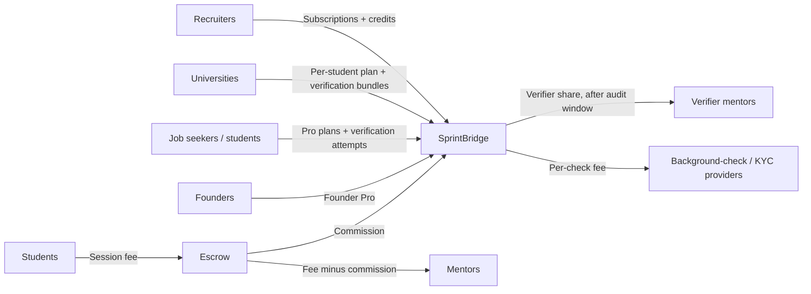

# SprintBridge — subscription business model

Design draft · 17 October 2026 · Companion to [architecture.md](architecture.md) and [threat-model.md](threat-model.md)

SprintBridge is a multi-sided portal. Each user type gets a free tier useful enough to join, and a paid plan priced to the value that type actually receives. **Every price below is an INR hypothesis to test in the pilot, not a decision.**

## 1. Principles

1. **The side that gains the most pays the most.** Recruiters and universities fund the platform. Students and job seekers pay little or nothing.
2. **Money buys access and time, never trust.** Paid plans never affect search ranking, eligibility, or verification outcomes. Verification fees are the same for pass and fail (see [threat-model.md](threat-model.md) §1.2).
3. **No one pays to be employed.** Employers can never charge candidates through the platform. Need-based fee waivers are funded by university or company sponsorship.
4. **Verified data is the product.** Recruiters pay because they trust the labels. Anything that weakens that trust (fabricated CSVs, rubber-stamp verifiers) reduces revenue directly.

## 2. Market anchors

| Reference | Data point | Use |
|---|---|---|
| Unstop Pro (student plan) | [₹1,999/yr](https://startup.outlookindia.com/sector/saas/unstop-launches-subscription-membership-unstop-pro-news-9537), bundling courses, mentorship discounts and rewards | Ceiling for student pricing |
| Topmate (mentor marketplace) | About [10% commission via the expert's own link, about 20% via the marketplace](https://adplist.org/guides/topmate-alternatives); see [pricing](https://topmate.io/pricing) | Mentor commission |
| Naukri Resdex (recruiter resume-database access) | Sold as custom annual subscriptions and credit bundles ([competitor summary](https://cutshort.io/naukri-alternatives)) | Recruiter credits + seats model |

## 3. Plans by actor

### Students (enrolled at a partner university)

| | Free | Pro: ₹149/mo or ₹999/yr |
|---|---|---|
| Profile, public applications, campus drives | ✓ | ✓ |
| Skill-gap view (coverage + missing skills) | ✓ | ✓ + detailed gap report and learning path |
| Resume analysis (System-assessed skills) | 1/month | Unlimited (fair use) |
| Fit + gap report for pasted JDs | 3/month | Unlimited |
| 48-hour skill-to-proof plans | — | ✓ |
| Grounded recruiter outreach drafts | — | 20/month |
| Mentor requests | 2/month | Unlimited |
| Mock-interview credits | — | 2/month |
| Academic-record verification (DigiLocker/NAD) | ✓ free; consent-based, cheap per fetch | ✓ |
| Skill verification | Sponsored by the university, or ₹499 per skill-level attempt | Same price; Pro adds no advantage in the result |

**What students get:** a path from skill gap to mentor to verified skill to campus drive, and proof recruiters trust.

### Job seekers (no university sponsor)

| | Free | Pro: ₹299/mo |
|---|---|---|
| Profile, public applications | ✓ | ✓ |
| Mentor requests | 2/month | Unlimited |
| Application insights (viewed / shortlisted timestamps) | — | ✓ |
| Resume analysis / JD fit + gap reports | 1 / 3 per month | Unlimited (fair use) |
| 48-hour skill-to-proof plans | — | ✓ |
| Grounded recruiter outreach drafts | — | 20/month |
| Skill verification | **₹999 per skill-level attempt**, including KYC, outcome-independent, 30-day retry cooldown | Same |

**What job seekers get:** a credibility signal that replaces a campus brand. This is the group that benefits most from external verification.

### Companies and recruiters (the main revenue engine)

| | Free | Starter: ₹4,999/mo | Growth: ₹14,999/mo | Enterprise |
|---|---|---|---|---|
| Recruiter seats | 1 | 1 | 5 | Custom |
| Active listings | 1 | 5 | Unlimited | Unlimited |
| Applicant profile views | 20/month | 300/month | Unlimited | Unlimited |
| Contact reveals (non-applicants) | — | 50 credits | 300 credits | Custom |
| Filter by `Mentor-verified` / `Academic record verified` | — | ✓ | ✓ | ✓ |
| Applicants sorted by fit with evidence breakdown | — | ✓ | ✓ | ✓ |
| Extracted-requirements assistant for listings | ✓ | ✓ | ✓ | ✓ |
| Campus-drive access | — | Partner universities only | All verified-data universities | ✓ + dedicated drives |
| Background-check results integration | — | — | ✓ | ✓ |
| Extra credits | — | ₹50/reveal | ₹40/reveal | Negotiated |

**What recruiters get:** fewer unqualified applicants, and verified skills plus verified academics without running their own screening round.

Company verification (GSTIN/CIN + work domain) is required before the first listing goes live on any plan.

### Universities

| | Free | Campus: ₹300–500 per enrolled student per year |
|---|---|---|
| Roster import (claim list) | ✓ | ✓ |
| Campus drives | 1 | Unlimited |
| Reports | Basic counts | Full, NAAC/NIRF-ready, CSV export |
| Academic-record verification for students | — | Included (issuer fetch); background-check fallback billed per check |
| Skill-verification bundles | — | Prepaid at a bulk discount (e.g. ₹399/attempt) |
| Alumni-mentor program | — | ✓ |
| "Verified data partner" badge | — | Unlocked by a high data-trust score |

**What universities get:** placement outcomes recruiters believe, because the data was verified outside the university. Honest data earns the badge and access to premium recruiters, so honesty pays (see [threat-model.md](threat-model.md) §2).

### Mentors

| | Free | Mentor Pro: ₹499/mo |
|---|---|---|
| Profile and listing | ✓ | ✓ + analytics |
| Paid sessions, platform commission | 20% marketplace / 10% own link | 10% / 5% |
| Eligible to verify skills | After KYC + calibration | Same; Pro does not change assignment odds |
| Verifier earnings | About 60% of each verification fee, released after the audit window | Same |

**What mentors get:** income, a verifier reputation, and escrow-protected payment.

### Founders and startups

| | Free | Founder Pro: ₹999/mo |
|---|---|---|
| Ventures | 1 | 3 |
| Collaboration requests received | 3/month | Unlimited |
| Filter collaborators by verified skills | — | ✓ |
| Tiered idea disclosure + NDA click-through | ✓ | ✓ |
| Team management | — | ✓ |
| Upgrade path | — | Convert to a company plan once hiring |

**What founders get:** vetted early teammates without exposing the idea to everyone.

## 4. Money flows

## 5. Entitlements and abuse controls

- Server-owned tables: `plans`, `subscriptions`, `entitlements`, `usage_counters`, `payments`, `payouts`. They are never writable through the Data API. Every limited action checks entitlements inside its RPC, using the same pattern as `role_grants`.
- Payment provider: Razorpay or Stripe with 3-D Secure. Webhook signatures are verified, and events are processed idempotently by provider event ID.
- The ranking and verification code takes **no plan input**, and a test enforces this.
- Abuse that monetization creates (trial cycling, chargebacks, seat sharing, scraping, payout fraud) is covered in [threat-model.md](threat-model.md) §5 and §9.

## 6. Pilot unit economics (illustrative assumptions)

One partner university, first year:

| Stream | Assumption | Annual revenue |
|---|---|---|
| University plan | 2,000 students × ₹400 | ₹8,00,000 |
| Recruiters | 15 Starter + 3 Growth, 12 months | ₹14,39,784 |
| Skill verification | 600 attempts × ₹450 average (sponsored + paid); platform keeps 40% after the verifier's 60% | ₹1,08,000 net |
| Student Pro | 3% of 2,000 × ₹999 | ₹59,940 |
| Mentor commission | 400 sessions × ₹500 × 15% blended | ₹30,000 |
| **Total** | | **≈ ₹24.4 lakh** |

Costs to set against this:
- KYC and issuer fetches (a few rupees to tens of rupees each)
- background-check fallbacks (billed through to the payer)
- paid hosting tiers
- one part-time trust-and-safety operator

The model works only if recruiters keep paying, and they pay only if the trust labels hold. Section 2 of the threat model is the core business risk.

## 7. Rollout

| Phase | Commercial scope |
|---|---|
| Hackathon | No payments. One pitch slide with this pricing table and the "money buys an attempt, never a result" principle. |
| Pilot | One university, manual invoicing, manually assigned verifiers using the conflict rules, DigiLocker integration, recruiters on Starter. |
| Production | Payment gateway, self-serve plans, automated verifier assignment, KYC, audit sampling, anomaly detection. |

## 8. Hypotheses to test in the pilot

1. Recruiters pay ≥ ₹4,999/mo for verified-skill filters (test: pre-sales letters of intent).
2. Universities accept external academic verification instead of their own CSV (test: pilot agreement terms).
3. Job seekers pay ₹999 per verification attempt even though the fee is not refunded on a fail (test: conversion from the gap-report page).
4. Verifier quality holds at 60% of the fee with audit holdbacks (test: audit disagreement rate < 10%).
