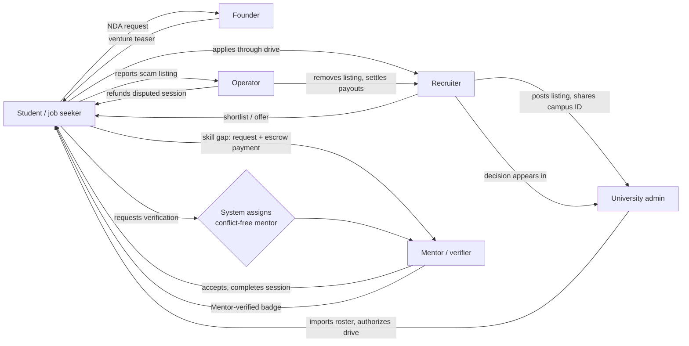

# SprintBridge — Round 2 showcase workflow

How every flow works from start to end, who is involved, and what the system does behind each step. Every flow below was run in the live app against the real database (18 October 2026); the "Result" lines are what we observed.

**Contents**
1. [The system in one picture](#1-the-system-in-one-picture)
2. [Before the demo](#2-before-the-demo)
3. [Accounts](#3-accounts)
4. [Flow A — Create an account](#flow-a--create-an-account-and-sign-in)
5. [Flow B — Campus placement, end to end](#flow-b--campus-placement-end-to-end-the-core-connectivity-story)
6. [Flow C — Skill gap → mentor → paid session](#flow-c--skill-gap--mentor--paid-session)
7. [Flow D — Independent skill verification](#flow-d--independent-skill-verification)
8. [Flow E — Venture Launchpad](#flow-e--venture-launchpad-entrepreneurs)
9. [Flow F — Plans, quotas and payments](#flow-f--plans-quotas-and-payments-test-mode)
10. [Flow G — Trust & safety](#flow-g--trust--safety)
11. [Security points to show](#11-security-points-to-show)
12. [Suggested 10-minute demo order](#12-suggested-10-minute-demo-order)
13. [What is real and what is simulated](#13-what-is-real-and-what-is-simulated)

---

## 1. The system in one picture

Six roles share one platform. Every arrow below is a live connection we demo.

| Layer | What it is |
|---|---|
| Frontend | React app at `http://127.0.0.1:5173` (redesigned, works on phones) |
| Backend | Python FastAPI at `http://127.0.0.1:8000/api` — verifies every login token (ES256 signature) |
| Database | Supabase PostgreSQL with row-level security on every table, plus database functions for every multi-step action, so rules hold even if someone calls the database directly |
| Auth | Supabase Auth with email confirmation |

---

## 2. Before the demo

1. **Start the backend:** `cd backend && .venv/bin/uvicorn app.main:app --host 127.0.0.1 --port 8000`
2. **Start the frontend:** `cd frontend && npm run dev` → open `http://127.0.0.1:5173`
3. **Reset to a clean state** (deletes all activity, keeps demo accounts, re-seeds sample data):
   `uv run --with 'psycopg[binary]' python database/reset_demo.py --yes`
4. **Use separate browser profiles** (or one normal + one private window) per role, so two people stay logged in at once. Sign out between roles otherwise.
5. **For live sign-ups (Flow A), configure email first** — see the note in Flow A. Without it, Supabase allows only ~2 emails per hour.
6. Optional: set `ANTHROPIC_API_KEY` in `backend/.env` to enable resume and job-description analysis. Without it those two pages show a clear "switched off" message and everything else works.

---

## 3. Accounts

Password for every demo account: shared privately with the team.

| Account | Role | Starting state |
|---|---|---|
| `student@demo.test` | Asha Rao — student, Demo University A | CSE 2027, CGPA 8.10, skills python + sql — **eligible** for the campus drive |
| `student2@demo.test` | Vikram Shah — student, Demo University A | CSE 2027, CGPA 7.50, skills java + sql — **not eligible** (no Python) |
| `recruiter@demo.test` | Ravi Menon — Acme Analytics | Recruiter Growth plan (unlimited listings) |
| `recruiter2@demo.test` | Lena Park — Globex Labs | Recruiter Starter plan; cannot see Acme's data |
| `admin.a@demo.test` | Dr. Kavya Nair — Demo University A | University Campus plan, 4 roster students, 1 drive |
| `admin.b@demo.test` | Prof. Imran Qureshi — Demo University B | Cannot see University A's data |
| `mentor@demo.test` | Arjun Mehta — Data engineering | ₹500/session; verified expert in python L3, sql L3, docker L2 |
| `mentor2@demo.test` | Sara Thomas — Frontend | Free; expert in react L3, typescript L3 |
| `mentor3@demo.test` | Neha Kulkarni — Backend & data | ₹800/session; expert in python L4, sql L3, java L3 |
| `founder@demo.test` | Kabir Malhotra — entrepreneur | Ventures: CampusEats (equity), SkillSwap |
| `operator@demo.test` | Priya — platform operator | Moderation, payouts, audit log |

---

## Flow A — Create an account and sign in

**Who:** a new visitor. **Shows:** self-service onboarding with email confirmation.

| # | Where | Action | What the system does |
|---|---|---|---|
| 1 | `/login` | Click **Create account** | The URL becomes `/login?mode=signup`, so it can be shared. |
| 2 | Sign-up form | Enter name, a real email, password twice | Checks the passwords match and are ≥ 8 characters. |
| 3 | Submit | **Create account** | Supabase creates the account (unconfirmed) and emails a confirmation link. A database trigger immediately creates the user's empty profile with their name. Screen: **"Check your inbox."** with **Resend link**. |
| 4 | Sign in before confirming | Enter email + password | Blocked: **"Your email isn't confirmed yet. Resend the confirmation link."** |
| 5 | Email | Open the confirmation link | Account is confirmed. |
| 6 | `/login` | Sign in | Lands on **Overview — "Hello, ‹name›."** with the *Your path* card (0 skills, 0 applications). |
| 7 | Menu | — | A new user sees only the student/job-seeker menu. Recruiter, University, Verifier and Operator areas don't appear: roles are granted by the platform, never self-assigned. |
| 8 | `/profile` | Add specialization and skills, save | Skills are cleaned up (lowercase, de-duplicated) and labelled **Self-declared**. |
| 9 | `/billing` | — | Not on a university roster → **Job Seeker** plans (₹299 Pro). Roster-linked users get **Student** pricing (₹149 Pro). |

**Error messages users see:** wrong password → "That email and password don't match"; existing email → "An account with this email already exists. Sign in instead"; invalid address → "Use a real email address you can open"; email limit → "We've sent too many emails in the last hour".

**Result (live):** a new account was created, blocked before confirmation, confirmed, signed in to its own dashboard, saved a profile, and was correctly placed on job-seeker pricing.

> **Before round 2:** Supabase's built-in email sender allows about 2 emails per hour. That limit is what stopped our second live sign-up test ("We've sent too many emails…"). In Supabase → **Authentication → Emails → SMTP Settings**, connect a provider (e.g. Resend, Brevo or Gmail SMTP) and raise the rate limit. Also set **Authentication → URL Configuration → Site URL** to the address the app runs on (e.g. `http://127.0.0.1:5173`), so confirmation links open the app.

---

## Flow B — Campus placement, end to end (the core connectivity story)

**Who:** recruiter → university → two students → recruiter → student → university. **Shows:** every party connected, with each one seeing only what they're allowed to.

| # | Role | Where | Action | What the system does |
|---|---|---|---|---|
| 1 | Recruiter (Ravi) | `/recruiter` → **Create opportunity** | Title, description, **Visibility: Campus**, required skills, deadline, stipend | Listing is saved for Acme only (the company plan's listing limit is checked). Campus listings are **invisible to students** until a university authorizes a drive. |
| 2 | Recruiter | **Your listings** | Click **Copy ID** under the campus listing | Gives the ID to share with a university (the company↔university link). |
| 3 | University (Dr. Nair) | `/university` → **Roster** | Upload CSV → **Preview** | Every row is validated; problems are listed by row and field (e.g. "CGPA must be between 0 and 10", "Duplicate student_id"). **Import is disabled while any row is invalid.** |
| 4 | University | Roster | **Import roster** | All rows or none are saved ("Imported: 2 added, 0 updated, 0 unchanged"). Re-importing updates instead of duplicating. Records are labelled **University-claimed**, never "verified". |
| 5 | University | **Campus drives** | Paste the ID, branches (CSE), batch 2027, min CGPA, mandatory skill (python), deadline → **Authorize drive** | Drive rules are frozen once published. The listing is now visible to this university's roster students only. |
| 6 | Student (Asha) | `/opportunities` → the listing | Choose **Application route: Demo University A · 2027** | Eligibility is checked against her university record and skills: **"Eligible for this drive"**. Skill coverage (e.g. 67%, 2 of 3 skills) is shown separately: coverage never overrides eligibility. |
| 7 | Student | Same page | **Apply for this opportunity** | One database transaction re-checks everything (deadline, drive, eligibility), saves a snapshot of her profile and eligibility, and blocks duplicates → **"Application received."** |
| 8 | Student (Vikram) | Same listing | Choose the drive | **"Not eligible — Python is required."** Apply is disabled. The missing skills show **Find a mentor** links (into Flow C). |
| 9 | Recruiter | `/recruiter` → **Applicants** | **Shortlist**, then **Mark offered** | Only the hiring company can change status, and only forwards (applied → shortlisted → offered/rejected). Every change is written to the audit log. |
| 10 | Student (Asha) | `/applications` | — | Tracker shows **Offered**, via **Campus drive**. |
| 11 | University | **Campus applicants** | — | Shows Asha · Data Engineering Intern · **Offered**. Only applications made through *this university's drives* appear. |
| 12 | University | **Overview** | **Export CSV** | KPIs: campus applications, shortlisted, offers, students with offers. CSV downloads with spreadsheet-formula protection. An offer is not counted as a placement. |

**Result (live):** listing created → 2 students imported → drive authorized → Asha eligible and applied → Vikram blocked with the reason → shortlisted → offered → Asha's tracker showed Offered → university saw it in applicants, KPIs (1 application, 1 offer, 1 student with an offer) and the CSV row.

**Isolation to point out:** Globex's recruiter cannot see Acme's applicants; University B cannot see University A's roster, drives or report; students never see other students' applications.

---

## Flow C — Skill gap → mentor → paid session

**Who:** student, mentor. **Shows:** gap analysis feeds mentor matching; escrow payments.

| # | Role | Where | Action | What the system does |
|---|---|---|---|---|
| 1 | Student | Listing → **Room to grow** | **Find a mentor** next to a missing skill | Opens `/mentors?skill=python`. |
| 2 | Student | `/mentors` | — | Mentors with **calibrated expertise** in that skill come first (**Verified expert** badge, levels like *python · L3*), then mentors who only self-declare it. **Price never changes the order.** |
| 3 | Student | Arjun's card | **Request mentorship** → note → **Continue · ₹500** | Paid mentor → a clearly labelled **Test mode** payment step ("no card is charged"). |
| 4 | Student | Same | **Confirm test payment & send** | One transaction: monthly quota check (free plan: 2 requests/month) + test payment + request. "₹500 is held in escrow and refunded if they decline." |
| 5 | Mentor (Arjun) | `/mentor-requests` → **Mentor inbox** | **Accept** | Only this mentor can decide. |
| 6 | Mentor | Same | **Mark session completed** | Payout created: **₹500 gross − ₹100 commission (20%) = ₹400**, **held 7 days** for disputes. (Mentor Pro: 10% commission.) |
| 7 | Mentor | `/billing` → **Earnings** | — | "Mentor session ₹500 ₹100 ₹400 — Held until ‹date›". |
| 8 | Mentor | `/billing` → **Your session price** | Change price | Takes effect for new requests. |

**If the mentor declines** → the payment is refunded automatically; both sides see **Refunded** (verified live: Vikram's ₹800 to Neha).
**If the student disputes** a completed session → see Flow F.

**Result (live):** Arjun and Neha ranked as verified Python experts with prices → ₹500 escrow → accepted → completed → ₹400 held in earnings.

---

## Flow D — Independent skill verification

**Who:** student, a system-chosen mentor, optionally a second mentor. **Shows:** the anti-fraud design. Students can't pick friends, and verifiers are paid the same for pass or fail.

| # | Role | Where | Action | What the system does |
|---|---|---|---|---|
| 1 | Student (Asha) | `/skills` → **Get mentor-verified** | Skill *python*, level *2 · Working* → **Request verification** | Before charging, the system checks a conflict-free verifier exists. If none: "No independent verifier is available… You have not been charged." |
| 2 | Student | Same | **Confirm test payment** (₹499 student / ₹999 job seeker) | The system **randomly assigns** a verifier who: has calibrated expertise ≥ the level; has a quality score ≥ 60%; **shares no organization** with her (college or employer); has **never had contact** with her (mentor requests, ventures); has never verified her; is not in a reciprocal pair with her; and hasn't hit the per-college monthly cap. |
| 3 | Student | Status table | — | "Verifier assigned — **Revealed when the session starts**." She cannot find or pressure the verifier in advance. |
| 4 | Verifier (Neha) | `/verify` (**Verifier desk**) | **Start session** | Her name now appears to the student. |
| 5 | Verifier | Same | Outcome **Pass**, level **2**, notes → **Record result** | She cannot certify above her own level. Her 60% share (₹299) is **held**. In 20% of cases a **blind second review** is sent to another independent mentor, who doesn't see the first result. |
| 6 | Student | `/skills` | — | Python shows **Mentor-verified · Level 2 · Verified until ‹+18 months›** with the verifier's notes. Fit scores now treat it as the strongest evidence. |

**Rules also in force (tested in the database):** a fail starts a **30-day cooldown**, and a retry always gets a **different** verifier. If a second reviewer disagrees, the badge goes **Under review**, the verifier's payout is **clawed back**, and their quality score drops.

**Result (live):** Asha had just had a session with Arjun, so the system assigned **Neha, not Arjun** (conflict rule). Neha was revealed at session start, passed Asha at L2, and Asha's Python became **Mentor-verified until Apr 2028**.

---

## Flow E — Venture Launchpad (entrepreneurs)

**Who:** founder, student. **Shows:** protecting founders' ideas while letting talent join.

| # | Role | Where | Action | What the system does |
|---|---|---|---|---|
| 1 | Founder (Kabir) | `/ventures` → **Post a venture** | Name, **public teaser**, **private full plan**, industry, stage, compensation type (paid / stipend / equity / unpaid / to discuss), skills needed | Founder Free allows 1 venture, Founder Pro 3 (posting beyond the limit shows "Founder Free includes 1 venture(s). Upgrade to post more."). |
| 2 | Student | `/ventures` | Browse, filter by a skill they can bring | Cards show stage, compensation and teaser. **The private plan is never sent to non-members** (the database blocks that column). |
| 3 | Student | Venture page | Write what they'd bring, tick **"I'll keep the founder's plan confidential"**, send | The request requires NDA acceptance (enforced in the database too). |
| 4 | Founder | Venture page → **Requests to join** | **Accept** | "‹name› joined." Collaborator count increases. |
| 5 | Student | Venture page | — | **The full plan is now visible.** Status: Accepted. |

**Result (live):** the founder saw the private plan; the student saw only the teaser; NDA request sent; founder accepted; the student then saw the full plan; a third venture was blocked by the free plan.

---

## Flow F — Plans, quotas and payments (test mode)

**Who:** everyone. **Shows:** a sustainable business model that never sells trust.

| # | Role | Where | What to show |
|---|---|---|---|
| 1 | Any user | `/billing` | **This month's usage** meters (job-fit reports, mentor requests, resume analyses) against plan limits; counted only when an action succeeds. |
| 2 | Student | `/billing` → **Upgrade to Student Pro** | Test-mode step: "This plan costs ₹149. Confirming records a simulated payment — no card is charged." → **Confirm test payment** → "You're now on Student Pro", limits become **∞**. |
| 3 | Recruiter / University | `/billing` | Organization plans: listing limits (Recruiter Free 1 / Starter 5 / Growth unlimited), university Campus plan priced per enrolled student per year. |
| 4 | Mentor | `/billing` | Mentor plans (commission 20% → 10%), session price, earnings with hold dates. |
| 5 | **Decline → refund** | Mentor declines a paid request | Payment flips to **Refunded** automatically, for both sides. |
| 6 | **Dispute → operator → refund** | Student: `/mentor-requests` → completed paid session → **Report a problem** → **Open dispute** | Session becomes **Disputed**; the held payout is frozen. |
| 7 | Operator | `/operator` → **Payouts to settle** | The disputed payout appears → **Refund** (or **Release**). The student's payment shows **Refunded**. **Release all due** pays out holds past their 7-day window. |

**Principles to say out loud:** paid plans never change search ranking or verification outcomes; verification costs the same whether you pass or fail; employers can never charge candidates.

**Result (live):** Student Free → Pro upgrade; Vikram's ₹800 refunded on decline; Asha's disputed ₹500 session refunded by the operator; all payments listed in each user's billing.

---

## Flow G — Trust & safety

**Who:** recruiter (bad actor), three students, operator. **Shows:** the platform protects candidates from scams automatically.

| # | Role | Where | Action | What the system does |
|---|---|---|---|---|
| 1 | Recruiter | `/recruiter` → Create | Description: "Pay a registration fee of Rs 1500… Contact WhatsApp only." | Scam-phrase detection flags it: *asks candidates to pay a fee*, *moves contact off-platform*. |
| 2 | Student | Listing page | — | Amber warning: **"Be careful with this listing… Genuine employers never charge candidates."** |
| 3 | 3 different users | Listing → **Report** → reason *Asks for money / scam* | Each user can report once. After **3 distinct reports** the listing is **hidden automatically** pending review; students now get "not found" and can't apply. The company still sees it. |
| 4 | Operator (Priya) | `/operator` | Report card: 3 reports, flags, "Hidden pending review" → **Remove listing** | Listing taken down. **Automatically flagged listings** and **Payouts to settle** are in the same console. |
| 5 | Operator | **Audit log** | — | Every sensitive action with who and when: payments, refunds, verification requests/sessions/results, reports, auto-hide, moderation, application status changes, drive authorizations. |

**Result (live):** warning shown → 3 reports → auto-hidden → operator removed it → audit log showed the full trail with real names.

---

## 11. Security points to show

- **Roles can't be self-assigned.** A new account gets no recruiter, university, mentor or operator powers. Those come only from the platform.
- **Every rule lives in the database**, not just the UI. In testing, direct database calls that bypass the app were refused for: granting yourself a role, posting for another company, inserting an application directly, editing CGPA, faking skill evidence, reading a founder's private plan, or reading the audit log.
- **Login tokens are verified on every request** (ES256 signature + expiry + issuer). A forged token gets `401`.
- **Organizations are isolated.** Companies and universities see only their own data.
- **Honest labels:** Self-declared → System-assessed → **Mentor-verified**; university data is "University-claimed".

---

## 12. Suggested 10-minute demo order

| Time | Flow | Accounts (separate browser profiles) |
|---|---|---|
| 0:00–1:00 | **A** — Create account, "check your inbox", sign in to a fresh dashboard | new email |
| 1:00–4:00 | **B** — Recruiter campus listing → university drive → Asha eligible + applies → Vikram blocked → recruiter offers → tracker + university report | recruiter, admin.a, student, student2 |
| 4:00–5:30 | **C** — Vikram's gap → Find a mentor → verified experts first → paid request (test payment) → mentor accepts & completes → earnings held | student, mentor |
| 5:30–7:00 | **D** — Request verification → system assigns a conflict-free mentor → verifier desk → Mentor-verified badge | student, mentor3 |
| 7:00–8:00 | **E** — Founder's teaser → NDA request → accept → plan unlocked | student, founder |
| 8:00–9:30 | **G + F** — Scam listing warning → reports → auto-hidden → operator removes; dispute → operator refunds | recruiter2, students, operator |
| 9:30–10:00 | Security points + business model one-liner | — |

Reset before each rehearsal: `database/reset_demo.py --yes`.

---

## 13. What is real and what is simulated

| Real (working end to end) | Simulated / not built |
|---|---|
| Accounts, email confirmation, login, roles, organization isolation | **Payments** use a clearly labelled *Test mode*; no card is charged. A real provider (e.g. Razorpay) can replace one database function later. |
| Listings, campus drives, eligibility, applications, decisions, reports, CSV | Live video for verification sessions: sessions happen outside the app; the result is recorded in it. |
| Mentor matching, escrow logic, commission, holds, refunds, disputes | ID / liveness checks (KYC) |
| Independent verification: conflict checks, random assignment, audits, expiry | DigiLocker / NAD academic record verification |
| Ventures with confidentiality | GitHub analysis, 48-hour proof plans, recruiter outreach drafts |
| Reports, scam flags, auto-hide, operator console, audit log | Resume / job-description analysis needs an `ANTHROPIC_API_KEY`; built and tested, switched off until a key is added |
